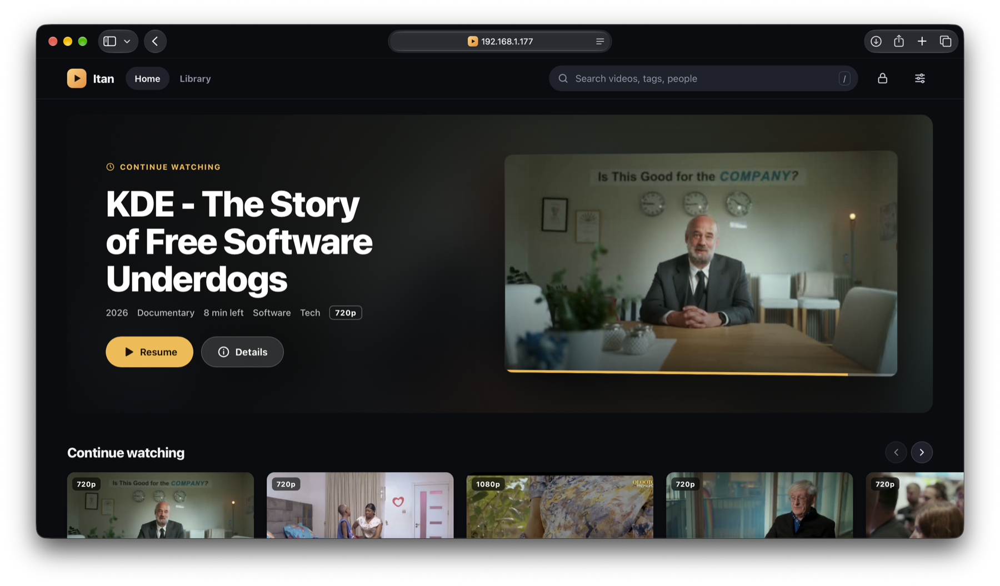
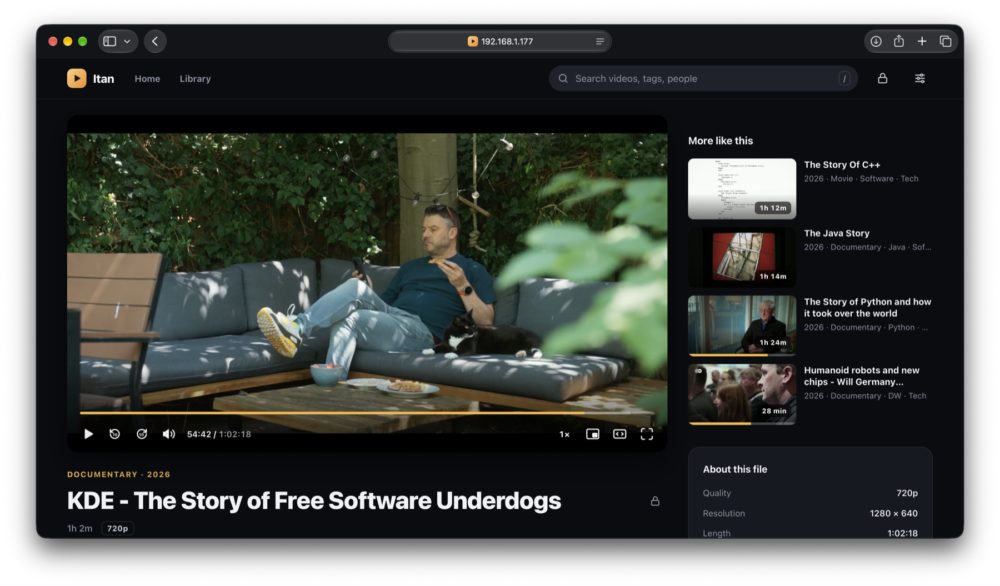
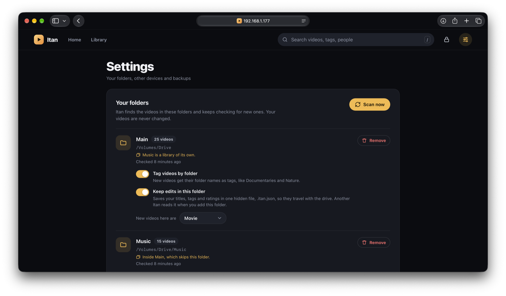

# Itan

*Ìtàn* is Yoruba for "story".

A lightweight, self-hosted video library for the files you already have.
Point it at your folders and watch on any device on your Wi-Fi.



- **Any folder layout.** No naming rules. Subfolder names become tags.
- **Tag-first.** Genres and tags are how you browse; filter by several at
  once, including "not this tag".
- **Your edits stick.** Every field records where its value came from; rescans
  never overwrite what you set.
- **Files are identified by content**, not path, so renames and moves keep
  their metadata.
- **Recommendations that explain themselves**, built from your own tags and
  watch history. Nothing leaves the server.
- **One small binary** with SQLite and the web UI built in. ffmpeg is optional
  but recommended.

<p>
  
  
</p>

> Status: early MVP. MP4/WebM files play directly. MKV files, and files with
> audio browsers can't play (DTS, AC3), are remuxed on the fly. Video a
> browser can't decode (HEVC on most browsers, XviD, VC-1, ...) is transcoded
> to H.264, using a hardware encoder when one is available.

## Download

Get the file for your computer from the
[latest release](https://github.com/hardope/itan/releases/latest) (the
release page says which one to pick), unpack it, and start it from a
terminal in that folder:

```bash
./itan -libraries "Videos=$HOME/Videos"
```

Install [ffmpeg](https://ffmpeg.org/download.html) as well, for thumbnails
and for videos browsers can't play as they are.

The downloads aren't signed yet, so the first run needs one extra step:

- **macOS** blocks files downloaded in a browser. Unblock it once with
  `xattr -d com.apple.quarantine itan`.
- **Windows** may show "Windows protected your PC". Click *More info*, then
  *Run anyway*.

## Run with Docker

The image `ghcr.io/hardope/itan` includes ffmpeg and runs on amd64, arm64
and 32-bit ARM (armv7, such as Raspberry Pi OS). Edit the video folder paths
in `docker-compose.yml`, then:

```bash
docker compose up -d
```

Open `http://<this-computer's-ip>:8080` on any device on the same network.

## Run from source

Needs Go 1.26+. Install `ffmpeg` (which includes `ffprobe`) for quality
detection and thumbnails.

```bash
go build -o itan ./cmd/itan
./itan -libraries "Videos=$HOME/Videos"
```

On startup the server logs the URLs other devices can use. You can also add
folders from the ⚙ page in the web UI.

## Configuration

| Flag | Env var | Default | |
|---|---|---|---|
| `-addr` | `ITAN_ADDR` | `:8080` | Listen address |
| `-data` | `ITAN_DATA` | `./data` | Database and thumbnails |
| `-libraries` | `ITAN_LIBRARIES` | | `"Name=/path;Other=/path2"`, registered on startup |
| `-scan-interval` | `ITAN_SCAN_INTERVAL` | `30m` | Periodic rescan, `0` to disable |
| `-ffprobe` | `ITAN_FFPROBE` | `ffprobe` | ffprobe binary |
| `-ffmpeg` | `ITAN_FFMPEG` | `ffmpeg` | ffmpeg binary |
| `-hwaccel` | `ITAN_HWACCEL` | `auto` | Transcoding encoder: `auto`, `none` (software), `videotoolbox`, `vaapi`, `nvenc` |
| `-max-transcodes` | `ITAN_MAX_TRANSCODES` | `2` | Simultaneous transcodes, `0` to disable transcoding |
| `-reset-pin` | | | Remove the edit PIN (if it's forgotten) and exit |
| `-version` | | | Print the version and exit |

## Libraries

A library is a folder, added in ⚙ Settings, with a kind for the new videos
found in it (Movie, Music video, Documentary…).

A library can be inside another one. Say the whole drive is a library called
*Main* with new videos marked Movie, and you add its `Music` folder as a
library with new videos marked Music video. Main then skips that folder:
videos in it are listed once, under Music, and new ones come in as music
videos. Settings shows which library is inside which.

Moving or renaming files is safe. A video is recognised by its content, so
it keeps its title, tags, rating and watch progress wherever it goes, even
into or out of a library inside another. Its old place is forgotten once the
scan finds it somewhere else. Removing an inner library hands its folder back
to the outer one on the next scan, edits intact.

## Series

Episodes are grouped into series and seasons. Files named the usual ways
are grouped automatically on each scan:

- `Show.S01E02.Episode Title.mkv`, `Show - 1x02 - Episode Title.mp4` (the
  show name comes from the file name, or from the folder if the name starts
  with `S01E02`)
- `Show/Season 1/02 - Episode Title.mkv`, `Show/Season 1/Episode 2.mp4`

Anything else can be grouped by hand: open a video's *Edit details* and fill
in *Series*, *Season* and *Episode* (leave the episode empty to add it at the
end). Grouping by hand always wins: rescans never move an episode you placed
or took out. *Edit series* renames a series, describes it, or splits it back
into separate videos.

A series shows as one card in the library. Its page lists the episodes by
season with what you've watched, and *Play* picks up where you are: the
episode in progress, or the one after the last one you finished. Episode
pages link back to the series and have a *Next episode* button.
Recommendations suggest a series by its next episode only.

## Edit PIN

Anyone on your network can watch, but you can keep them from changing
things. Set a PIN in Settings, and editing titles, tags, ratings, series,
folders and backups asks for it once per device. Favorites and resume
points stay free. The lock button in the header shows whether this device
can make changes, and locks it again.

Five wrong PINs from one device pause further tries for 30 seconds, doubling
each time up to 15 minutes. Forgot it? Stop Itan and run `itan -reset-pin`
on the computer it runs on.

## Watching

Press play on any video. Nothing is converted until you do, so browsing
never ties up the server. The player remembers where you stopped, works the
same for every file type, and offers what to watch next when a video ends.
Editing details, tags, your rating or favorites happens in place, without
interrupting playback.

On a computer the player starts medium-sized, with "More like this" beside
it. The wide button (or T) makes it span the page; each browser remembers
which you prefer. Phones always get the full width. On touch screens, double
tap the left or right of the video to skip 10 seconds.

| Key | |
|---|---|
| Space or K | Play / pause |
| ← → | Back / forward 5 seconds |
| J L | Back / forward 10 seconds |
| 0–9 | Jump to 0%–90% |
| F | Full screen |
| T | Wide / default view |
| M | Mute |
| / | Search |

## How it works

1. **Scan**: walks each library and skips files whose size and modification
   time haven't changed. New files get a `ph1` content hash (xxh3 of size +
   first and last 1 MiB), so a 50 GB file costs about 2 MB of reads.
2. **Detect**: guesses title, year and episode from the file name, turns
   folders into tags, and reads resolution, codecs, HDR and tracks with
   ffprobe. It also decides whether the browser can play the file directly.
3. **Serve**: files the browser can play are served as they are, with HTTP
   range requests, so seeking is instant and the server does almost no work.
   Everything else is **remuxed**: ffmpeg repackages it into HLS segments with
   the video copied, not re-encoded (audio is converted to AAC if needed). That
   takes a few percent of one CPU core. Segments go to `<data>/transcode/`
   while someone is watching and are deleted when the session ends or sits
   idle for 5 minutes. Note that this temp folder can grow to the size of the
   video being watched.
4. **Transcode**: if the browser can't decode the video codec, the same
   pipeline re-encodes the video to H.264 (scaled down to 1080p at most).
   The player decides this per browser: Safari plays HEVC by copying, while
   Chrome without HEVC support gets a transcode. Transcoding runs at up to 2x
   real time after a 30-second head start, so a paused video doesn't keep the
   CPU busy. When all `-max-transcodes` slots are taken, a new viewer can take
   over a slot nobody has fetched from in 30 seconds (a closed tab, or a long
   pause: that player restarts its stream when it resumes).

### Hardware transcoding

With `-hwaccel auto` (the default), the server tries the hardware encoder for
its platform on the first transcode, by encoding a test clip:

| Platform | Encoder | Notes |
|---|---|---|
| macOS | VideoToolbox | Works out of the box |
| Linux, Intel/AMD GPU | VAAPI | Needs `/dev/dri/renderD128`. In Docker, pass the device through (see `docker-compose.yml`) |
| Linux/Windows, NVIDIA | NVENC | Needs the NVIDIA driver; in Docker, the NVIDIA Container Toolkit |

If none work, it falls back to software (libx264), which handles about one
1080p stream on a modest 4-core CPU. The log says which encoder is used.

## Recommendations

The home page shows recommendation rows above the full list, and every video
page has *More like this*. Everything is computed on the server from your
library's metadata and watch history. There are no external services and no
training step.

| Row | What's in it |
|---|---|
| Recommended for you | Unwatched videos closest to your taste, mixed so one genre doesn't fill the row |
| Because you watched *X* | Like one of the two videos you watched most recently |
| Something different | Unwatched videos far from your usual, in a new order each day |
| Recently added | Shown instead of the rows above until there's some history |

Each card says why it's there: "Because you liked Ocean Giants" or, on *More
like this*, the tags two videos share. A row with fewer than three videos is
hidden.

**What counts.** Each video's genres, tags, people, moods, collections, kind,
decade and language become its "fingerprint". Rare tags count for much more
than common ones: sharing a director says more than both being "Movies".
Tags made from folder names count for half. Your taste is built from:

- **For:** finishing a video (more if rewatched), watching a good part of it,
  ♥ favorites, and ratings of 6 to 10.
- **Against:** ratings of 1 to 4, and stopping in the first minutes of a video
  you never came back to after a week.

Viewing signals fade over about four months; favorites and ratings don't. So
the quickest ways to steer recommendations are the ♥ button, the rating
field, and good tags.

Library fingerprints are cached for up to a minute after a scan (edits made in
the app apply immediately). Watch history is read fresh on every request. On a
10,000-video library a request takes about 30 ms.

## Backup, restore and moving between devices

Everything you create (titles, descriptions, ratings, genres and tags,
removed tags, collections and watch history) can leave the server in two
ways. Both are described in [docs/export-format.md](docs/export-format.md).

- **Export file**: ⚙ → *Backup & restore* → *Download export*. One JSON file
  for the whole library (add `gzip=1` to the API call for a `.json.gz`). Import
  it on another install with *Preview* first to see what would change, then
  *Import*:
  - **Merge** (default) keeps your edits on the receiving side when both sides
    changed the same field (the newer user edit wins), and never lets an
    auto-detected value overwrite a user edit.
  - **Replace** lets the file win every conflict.

  Videos are matched by content, so renamed or moved files keep their
  metadata. Re-encoded files are matched by library name and path instead.
  Videos that aren't on the receiving server yet are kept as *pending* and
  applied automatically when a scan finds them, so you can import before the
  drive is plugged in.
- **A file in the folder**: turn on *Keep edits in this folder* for a
  library, and your edits are saved in one hidden file, `.itan.json`, at
  the folder's root. Plug the drive into another computer running Itan
  and add the folder: the edits come along, even if the folder has another
  name there or some videos were renamed or re-encoded. Edits made on either
  computer are merged the next time the other one scans. The file covers the
  whole folder, including libraries inside it, so one file per drive is
  enough. Watch history isn't included. This needs write access to the folder, so it won't work with a
  read-only (`:ro`) Docker mount. Older versions wrote one `.meta.json` per
  video; those are folded into `.itan.json` and removed when you turn the
  option on.

## API

| | |
|---|---|
| `GET /api/items?q=&tag=&exclude=&kind=&quality=&sort=&limit=&offset=` | List and search. `tag`/`exclude` are repeatable refs like `genre:music`. `X-Total-Count` has the number of matches |
| `GET /api/items?shelf=continue` | Partially watched |
| `GET /api/items?group=0` | Episodes one by one instead of one card per series |
| `GET /api/items/{id}` | Details, tags, tracks, files, field sources |
| `PATCH /api/items/{id}` | Edit fields, `add_tags`, `remove_tags`, `series` (`{"title", "season", "episode"}` or `null`) |
| `GET /api/series`, `GET /api/series/{id}` | Series names; one series with its seasons, episodes and what to play next |
| `PATCH/DELETE /api/series/{id}` | Rename or describe a series; split it into separate videos |
| `GET /api/auth`, `POST /api/auth/unlock`, `POST /api/auth/lock` | Edit PIN state; unlock (`{"pin"}`) or lock this device |
| `PUT/DELETE /api/auth/pin` | Set or change (`{"current", "pin"}`), or remove (`{"current"}`) the edit PIN |
| `POST /api/items/{id}/progress` | Save resume position |
| `PUT /api/items/{id}/favorite` | `{"favorite": true}` |
| `GET /api/info` | Addresses other devices on the network can use |
| `GET /api/recommendations?limit=` | Home page rows: `{"shelves": [{id, title, items}]}`, each item with a `reason` |
| `GET /api/items/{id}/similar?limit=` | More like this |
| `GET /api/items/{id}/thumbnail` | JPEG, generated on first request |
| `GET /api/tags` | Tags with item counts |
| `GET/POST /api/libraries`, `PATCH/DELETE /api/libraries/{id}` | Manage folders; PATCH sets `write_sidecars` (keep `.itan.json`), `folder_tags`, `default_kind` |
| `GET /api/export?history=1&gzip=1` | Download all metadata |
| `POST /api/import?mode=merge\|replace&dry_run=1` | Import an export file (request body, plain or gzipped) → report |
| `GET/POST /api/scan` | Scan status / start a scan |
| `GET /stream/{id}` | The video file (direct play) |

With an edit PIN set, the requests that change things (`PATCH`/`POST`/`DELETE`
on items, series, libraries and import) and `GET /api/export` need an
unlocked device; otherwise they answer `401 {"locked": true}`.

| | |
|---|---|
| `POST /api/items/{id}/hls` | Start a session: `{"session": "...", "start": 0, "transcode": false}` → playlist URL and encoder used |
| `GET /hls/{session}/{file}` | Playlist and segments |
| `DELETE /api/hls/{session}` | Stop a session |

## Layout

```
cmd/itan/          entry point
internal/config/       flags and env vars
internal/db/           schema.sql, migrations, tag helpers, search index
internal/scanner/      walk, ph1 hash, filename parsing, ffprobe
internal/metadata/     export, import, folder files, pending imports
internal/recommend/    recommendations: feature vectors, taste, diversity
internal/server/       HTTP API, streaming, thumbnails
internal/server/web/   web UI (plain HTML/CSS/JS, embedded in the binary)
docs/                  metadata export format spec, README screenshots
```

## Roadmap

- HDR → SDR tone mapping when transcoding (HDR currently looks washed out)
- External subtitles (SRT → WebVTT)
- "Not interested" on recommendations; detecting multi-part films ("Part 1", "Part 2")
- mDNS (`itan.local`), installable PWA, multiple profiles

## Releases

Pushing a version tag publishes a release:

```bash
git tag v0.1.0
git push origin v0.1.0
```

GitHub Actions then puts the downloads for each platform on the release page
([.goreleaser.yaml](.goreleaser.yaml)) and the Docker image on
`ghcr.io/hardope/itan`. Tags like `v0.2.0-rc.1` become pre-releases. Every
push to `main` runs the tests on Linux, macOS and Windows and checks that
both still build.

## License

Copyright (C) 2026 Opeoluwa Adeyeri

Itan is free software under the [GNU Affero General Public License, version 3](LICENSE).
You can use, change and share it. If you change it and let others use your
version over a network, you must offer them its source code too.

The web UI bundles [hls.js](https://github.com/video-dev/hls.js), which is
under the Apache License 2.0 ([its license](internal/server/web/vendor/hls.js.LICENSE)).
